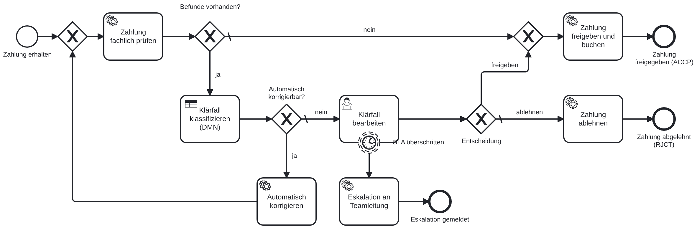
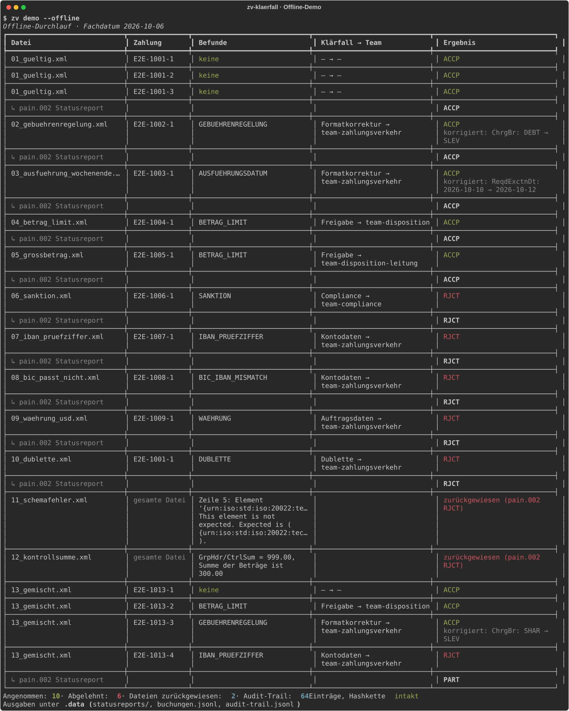
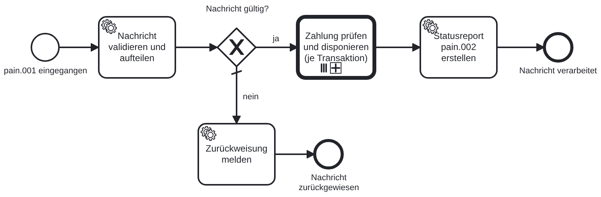
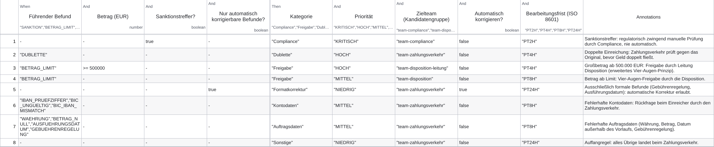
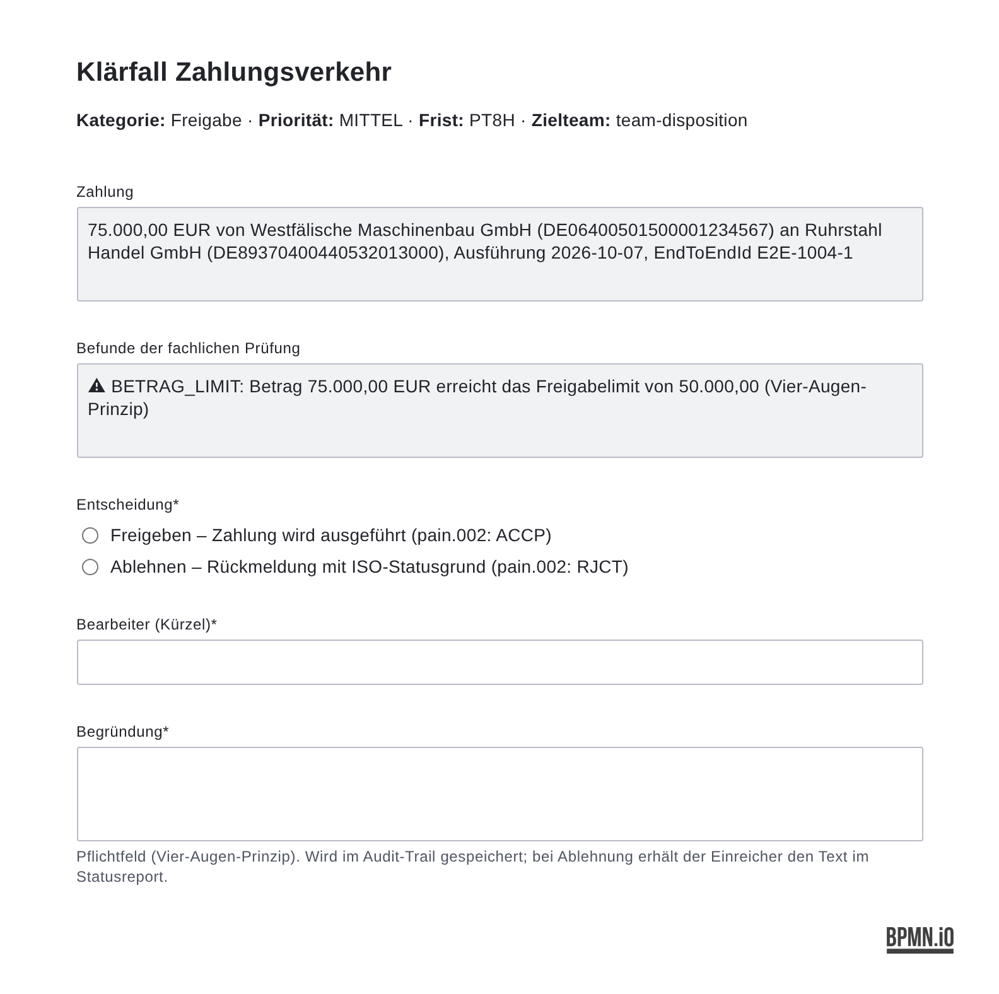
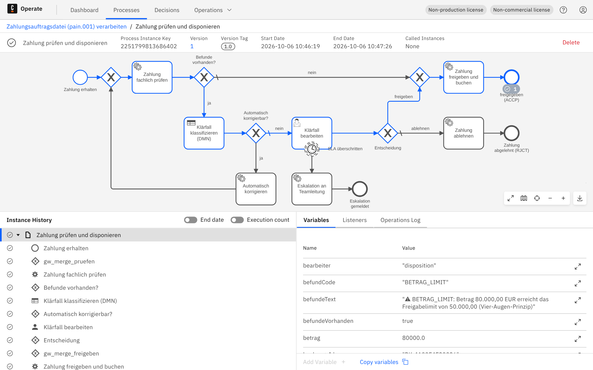
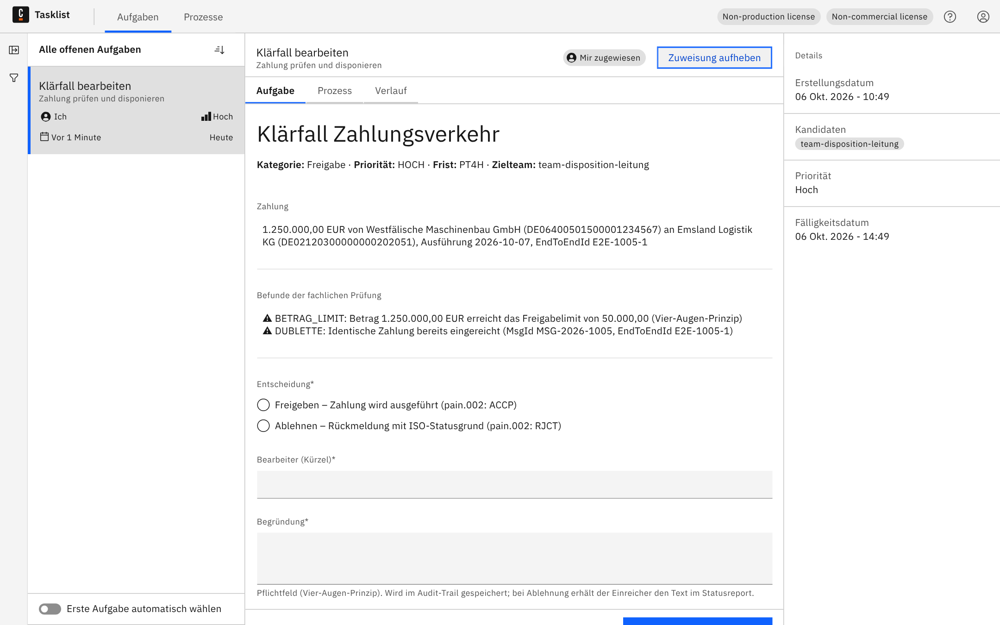

# Klärfallbearbeitung im Zahlungsverkehr mit Camunda 8

**ISO-20022-Zahlungsaufträge (pain.001) technisch und fachlich prüfen, Klärfälle per DMN klassifizieren
und an das richtige Team routen, formale Mängel automatisch korrigieren, jede Entscheidung revisionssicher
protokollieren und dem Einreicher einen standardkonformen pain.002-Statusreport zurückgeben.**

[](https://github.com/jonathankuhn11-spec/zv-klaerfall-camunda/actions/workflows/ci.yml)


[](LICENSE)



---

## Worum es geht

Firmenkunden reichen Sammelüberweisungen als `pain.001`-Datei ein. Vor der Ausführung muss die Bank jede
Zahlung **disponieren**: Ist die Datei technisch in Ordnung? Stimmen IBAN und BIC? Liegt der Betrag über
dem Freigabelimit? Ist ein Empfänger sanktioniert? Wurde die Zahlung schon einmal eingereicht? Und wer
entscheidet in welcher Frist, wenn etwas nicht passt?

Dieses Projekt setzt diesen Prozess durchgängig um – vom XSD bis zum Audit-Trail – und zeigt dabei die
Arbeitsweise an der Schnittstelle zwischen Fachbereich und IT:

| Fachliche Seite | Technische Seite |
|---|---|
| [Fachkonzept](docs/fachkonzept.md) mit Befundkatalog, Rollen, SLAs, ISO-Statusgründen | Camunda 8.9: BPMN mit Call Activity + Multi-Instance, DMN (Hit-Policy FIRST), User Task mit Formular, nicht unterbrechender SLA-Timer |
| [User Stories mit Abnahmekriterien](docs/anforderungen.md), rückverfolgbar auf Tests | Python-Worker gegen die Orchestration Cluster REST API v2 (ohne SDK, mit `respx` testbar) |
| [Testkonzept](docs/testkonzept.md) mit Risikoanalyse und Testfallkatalog | 77 automatisierte Tests, mypy strict, Ruff, bpmnlint (camunda-cloud-8-9), dmnlint, Integrationstest gegen echten Cluster |
| Entscheidungsregeln in der Hoheit des Fachbereichs (DMN-Tabelle mit Begründungen) | Offline-Pipeline: derselbe Prozess ohne Cluster in Sekunden, für Demo und CI |
| Revisionssichere Nachweisführung | Append-only Audit-Trail mit SHA-256-Hashkette, Manipulation und Lücken werden erkannt |
| [Architekturentscheidungen (ADRs)](docs/adr/) | Validierte ISO-20022-Nachrichten (pain.001.001.09 / pain.002.001.12, offizielle XSDs) |

## Schnellstart ohne Camunda (10 Sekunden)

```bash
git clone https://github.com/jonathankuhn11-spec/zv-klaerfall-camunda.git && cd zv-klaerfall-camunda
pip install -e ".[dev]"
zv demo --offline
```



Was passiert: 13 Beispieldateien (fehlerfrei, formal korrigierbar, Vier-Augen-Freigabe, Sanktionstreffer,
Dublette, Schemafehler, falsche Kontrollsumme, gemischt) laufen durch exakt die Logik, die auch im Cluster
läuft. Danach liegen unter `.data/` die `pain.002`-Statusreports (XSD-validiert), das Buchungsjournal und
der Audit-Trail; `zv audit verify` prüft dessen Hashkette.

```bash
zv demo --offline --interaktiv          # Klärfälle selbst im Terminal entscheiden
zv demo --offline --sla-ueberschritten  # Eskalation bei Fristüberschreitung simulieren
zv validate samples/pain.001/13_gemischt.xml   # nur prüfen, alle Befunde anzeigen
zv audit show --referenz E2E-1013-4     # Entscheidungsspur einer einzelnen Zahlung
```

## Schnellstart mit Camunda 8

Voraussetzung: Docker. Startet den Orchestration Cluster (Zeebe, Operate, Tasklist, Identity in einem
Container, ca. 1,5 GB RAM):

```bash
docker compose -f docker/docker-compose.yaml up -d    # Operate/Tasklist: http://localhost:8080, demo/demo
zv deploy                                             # BPMN, DMN und Formular deployen
zv ingest                                             # je Beispieldatei eine Prozessinstanz starten
zv worker                                             # Job-Worker für alle zv.*-Service-Tasks
```

Jetzt die Klärfälle in **Tasklist** (`http://localhost:8080/tasklist`) bearbeiten – oder per CLI:

```bash
zv tasks list --gruppe team-disposition
zv tasks complete <taskKey> --entscheidung FREIGEBEN --bearbeiter jk --kommentar "Vier-Augen-Freigabe erteilt"
zv tasks auto                                         # alle offenen Klärfälle mit der Demo-Policy entscheiden
zv status                                             # Topologie, aktive und abgeschlossene Instanzen
```

In **Operate** sind die Instanzen, die ausgewertete DMN-Tabelle und alle Variablen sichtbar. Der Worker
kann alternativ im Container laufen: `docker compose -f docker/docker-compose.yaml --profile app up -d`.

## Der Prozess in 60 Sekunden

**1. Datei verarbeiten** – XSD-Prüfung und Kopfdaten-Plausibilität (`NbOfTxs`, `CtrlSum`). Ungültige
Dateien werden als Ganzes mit `pain.002` `RJCT` + Statusgrund (`FF01`, `AM10`) zurückgewiesen. Gültige
Dateien werden je Transaktion parallel disponiert (Call Activity, Multi-Instance) und am Ende zu einem
Statusreport aggregiert (`ACCP` / `PART` / `RJCT`).



**2. Zahlung prüfen** – der Befundkatalog liefert Befunde mit Schweregrad, Rang und ISO-Statusgrund:

| Befund | Prüfung | Auto-Korrektur | pain.002 |
|---|---|---|---|
| `SANKTION` | Namensabgleich mit Normalisierung und Fuzzy-Match ≥ 85 % | nie | `RR04` |
| `BETRAG_LIMIT` | ≥ 50.000 EUR (Task-Header, ohne Codeänderung änderbar) | nein | `AM02` |
| `DUBLETTE` | gleicher Fingerprint innerhalb von 24 h | nein | `DUPL` |
| `IBAN_PRUEFZIFFER`, `BIC_IBAN_MISMATCH`, `BIC_UNGUELTIG` | ISO 7064, Bankleitzahlregister | nein | `AC01`, `RC01` |
| `WAEHRUNG`, `BETRAG_NULL` | SEPA nur in EUR, Betrag > 0 | nein | `AM11`, `AM01` |
| `GEBUEHRENREGELUNG` | `ChrgBr` muss bei SEPA `SLEV` sein (EPC-Rulebook) | **ja** | `CH16` |
| `AUSFUEHRUNGSDATUM` | TARGET2-Bankarbeitstag, nicht in der Vergangenheit, max. 90 Tage Vorlauf | **ja** (Verschiebung) | `DT01` |

**3. Klärfall klassifizieren** – die DMN-Tabelle entscheidet über Kategorie, Priorität, Zielteam, Frist und
ob automatisch korrigiert werden darf. Sie ist das Instrument des Fachbereichs; jede Regel trägt ihre
Begründung:



**4. Klärfall bearbeiten** – User Task mit Kandidatengruppe aus der Klassifikation, Fälligkeit `jetzt + SLA`,
Priorität 90/70/50/30. Freigabe oder Ablehnung mit Pflicht-Begründung. Ein nicht unterbrechender Timer
eskaliert bei Fristüberschreitung, ohne den Klärfall abzubrechen.

<p align="center"></p>

**5. Nachweis** – jeder Schritt landet im Audit-Trail, abgelegt mit Zeitstempel, Akteur und Hash des Vorgängers:

```
$ zv audit show --referenz E2E-1013-2
┃ Zeit            ┃ Ereignis            ┃ Referenz   ┃ Akteur      ┃ Daten                                              ┃
│ 06.10. 10:46:19 │ ZAHLUNG_GEPRUEFT    │ E2E-1013-2 │ system      │ {"befunde": ["BETRAG_LIMIT"], "fuehrenderBefund": … │
│ 06.10. 10:47:26 │ ZAHLUNG_FREIGEGEBEN │ E2E-1013-2 │ disposition │ {"buchungsId": "BK-4A22F4E32936", "kommentar": "Vi… │
$ zv audit verify
✓ Audit-Trail intakt (66 Einträge, .data/audit-trail.jsonl)
```

## Verifiziert gegen die echte Engine

Alle 13 Beispieldateien wurden gegen einen lokalen Camunda-8.9.22-Cluster verarbeitet (`zv deploy`,
`zv ingest`, `zv worker`, Klärfälle in Tasklist): 47 Jobs ohne Fehler, Ergebnisse identisch mit dem
Offline-Durchlauf, pain.002-Reports XSD-gültig, nicht unterbrechender SLA-Timer mit Eskalation bestätigt.

Operate zeigt den gelaufenen Pfad einer Zahlung über DMN, Klärfall, Entscheidung und Freigabe – inklusive
aller Variablen:



Tasklist rendert das Formular mit den Prozessvariablen; Kandidatengruppe, Priorität und Fälligkeit kommen
aus der DMN-Klassifikation:



## Projektstruktur

```
bpmn/                      Prozessmodelle (BPMN 2.0), Entscheidungstabelle (DMN 1.3) – generiert, gelintet
forms/                     Camunda-Formular für den Klärfall-User-Task
samples/pain.001/          13 Beispielszenarien mit Erwartungswerten (README dort)
src/zv_klaerfall/
  iso20022/                pain.001-Parser, pain.002-Generator, offizielle XSDs
  rules/                   Befundkatalog, TARGET2-Kalender, Sanktionsabgleich, Dubletten, DMN-Light
  handlers.py              Fachlogik je Service Task (reine Funktionen, offline und im Worker identisch)
  camunda/                 REST-Client (API v2) und Job-Worker
  pipeline/offline.py      Prozessablauf ohne Cluster
  audit/trail.py           Audit-Trail mit Hashkette
  cli.py                   zv validate | demo | deploy | ingest | worker | tasks | audit | status
tests/                     Unit, Komponenten, Pipeline (alle Beispiele), Modell-Code-Konsistenz, Integration
tools/                     Generatoren für Modelle und Beispiele, Rendering der Diagramme
docs/                      Fachkonzept, Anforderungen, Testkonzept, Architektur, ADRs, Bilder
docker/                    Camunda 8.9 Compose (aus dem offiziellen Artefakt abgeleitet), Worker-Dockerfile
```

## Qualitätssicherung

| Stufe | Werkzeug | Umfang |
|---|---|---|
| Statisch | Ruff, mypy `--strict` | Code, Tests, Tools |
| Modelle | bpmnlint `camunda-cloud-8-9`, dmnlint | 0 Befunde |
| Unit / Komponenten | pytest, respx | Parser, Regeln, Kalender, Sanktionen, Dubletten, DMN-Tabelle, Audit-Trail, REST-Client, Worker |
| Konsistenz | pytest | Job-Typen = Handler, Decision-ID, Form-ID, Gateway-Defaults, Variablenvertrag |
| End-to-End offline | pytest | 13 Beispieldateien gegen Erwartungswerte, jeder pain.002 XSD-validiert |
| Integration | pytest `-m integration` | echter Cluster: Deployment, Instanzen, Worker, User Task per API |
| CI | GitHub Actions | Matrix Python 3.11–3.13, Modell-Lint, Generator-Abgleich, Docker-Build, Integration mit Compose |

```bash
make check          # Ruff, Mypy, bpmnlint, dmnlint, pytest
make models samples # BPMN/DMN/Formular und Beispiele neu generieren (CI prüft Übereinstimmung)
make diagrams       # Bilder in docs/img neu rendern (bpmn-js/dmn-js in Headless-Chromium)
```

## Technologie

Camunda 8.9.22 (Orchestration Cluster, REST API v2, Camunda Forms) · Python 3.11+ · lxml (XSD) ·
pydantic · httpx · schwifty (IBAN/BIC, Bankleitzahlregister) · typer/rich · pytest/respx · Ruff · mypy ·
bpmnlint + camunda-compat · dmnlint · bpmn-js/dmn-js/form-js (Rendering) · Docker Compose.

Die ISO-20022-Schemata stammen aus dem offiziellen ISO-Katalog (Standards Editor, Version 2019); die
Statusgründe folgen den ISO-20022-External-Code-Sets.

## Grenzen und nächste Schritte

Das ist ein Referenzprojekt, kein Produktivsystem: Sanktionsliste und Buchungssystem sind lokale
Stellvertreter, Deckungsprüfung und Berechtigungskonzept fehlen, der Audit-Trail ist manipulations-
*erkennbar*, nicht manipulations-*sicher* (produktiv: WORM-Speicher). Konkret offene Punkte stehen im
[Fachkonzept, Kapitel 10](docs/fachkonzept.md#10-offene-punkte-für-eine-produktive-einführung).

## Autor

Jonathan Kuhn · [LinkedIn](https://linkedin.com/in/jk-kuhn) · [GitHub](https://github.com/jonathankuhn11-spec)
Hintergrund: Analyse und Automatisierung energiewirtschaftlicher Marktkommunikation (EDIFACT, GPKE) –
dieses Projekt überträgt dieselbe Arbeitsweise (Nachrichtenstandard verstehen, Prozess modellieren,
Regeln explizit machen, Klärfälle sauber routen) auf den Zahlungsverkehr.

Lizenz: [MIT](LICENSE)
